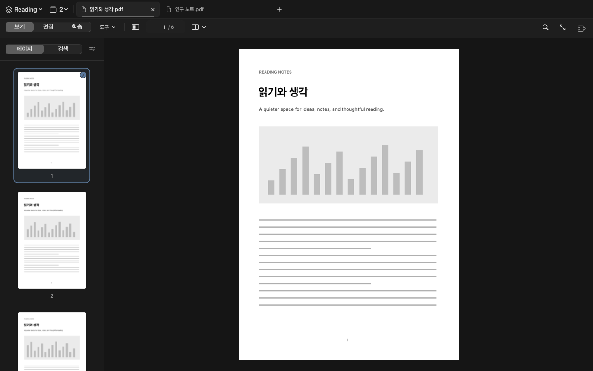

# 읽기 화면 간소화와 누적 소스 갱신 — 2026-10-01

공개 소스 `1637a70` 이후의 변경을 **0.9.0 (build 20) Developer Preview**에 통합했다. 읽기 화면·방향키·썸네일 개선뿐 아니라 페이지별 OCR, 텍스트 선택 복구, 앱 안 번역, 입문 학습 문서와 관련 검사를 함께 공개한다. 버전은 유지하며 이번 작업은 소스·문서 반영이다. GitHub Releases의 마지막 다운로드 배포본은 **0.8.0 (build 18)**이다.

## 문서에 집중하는 화면

- 시작 화면을 파일 열기와 최근 문서 목록 중심으로 줄였다. 큰 안내 카드·장식 문구·배지를 덜고, 열기·개별 제거·목록 비우기는 유지했다.
- 다크 화면은 차콜, 라이트 화면은 부드러운 회색을 사용한다. 탭·카드의 테두리와 그림자, 강조색 면적을 줄였다.
- 탭 막대는 40pt, 기본 도구줄은 42pt로 정리했다. 탭 스택·워크스페이스·끌어서 재정렬하는 동작은 유지한다.
- 검색은 버튼이나 `⌘F`로 펼치고 `Esc`로 닫는다. 저장·실행 취소는 편집 상태에 맞게 나타나며, 편집·학습 모드에서는 해당 도구가 자동으로 열린다.
- 화면 배치와 폭·높이 맞춤, 패널 위치는 팝오버에서 조정한다. PDF 비교와 리소스 모니터는 열린 탭 메뉴에서 찾을 수 있다.
- 페이지 패널의 1·2·4장 묶음과 썸네일 확대 비율은 옵션 팝오버로 옮겼다. 기존 기능을 유지하면서 읽을 때 보이는 조절 장치를 줄였다.



위 이미지는 실제 SwiftUI 도구·탭·페이지 패널과 직접 만든 예제 페이지 이미지로 렌더링한 미리보기다. PDFKit 본문까지 실행한 창 캡처와는 구분한다. 라이트·다크 시작 화면은 [README](../README.md), 제작 방식과 체크섬은 [자산 기록](../ASSETS.md)에 있다.

## 썸네일 크기와 방향키

페이지 패널의 실제 가용 너비·높이를 기준으로 썸네일 크기를 계산한다. 왼쪽·오른쪽 패널을 넓히거나 상단·하단 패널을 높이면 썸네일도 커진다. 페이지의 자르기 영역과 회전을 반영한 비율을 유지하고, 크기 조절 중에는 기존 이미지를 보여 주다가 새 크기의 이미지를 교체한다.

1·2·4장 옵션은 썸네일을 한 페이지, 책의 펼침, 네 페이지 단위로 묶어 탐색하는 기존 기능이다. 본문의 화면 배치와 별개이며, 이번에는 삭제하지 않고 옵션 안에 보관했다.

| 입력 | 현재 동작 |
| --- | --- |
| 방향키 길게 누르기 | 운영체제의 키 반복 설정과 독립적으로 연속 이동. 보통 속도는 이전 기본 대비 약 1.8배 |
| `Shift + 방향키` | 이전 기본 대비 약 4배, 새 보통 속도 대비 약 2.2배 |
| `Option + 방향키` | 기존 PDFKit 페이지 이동 유지 |
| 설정의 이동 속도 | 느리게·보통·빠르게 선택 |

본문의 보통 반복 간격은 0.05초, Shift를 함께 누르면 0.0225초다. 이는 반복 입력 간격 기준이며 문서의 실제 렌더링 시간까지 보장하는 값은 아니다. 키를 놓거나 창·앱이 비활성화되거나 문서·시트 상태가 바뀌면 반복을 중단한다. 텍스트 편집·선택 동작과 입력창의 방향키는 보존한다.

## OCR과 텍스트 선택

- 전체·현재·직접 지정한 페이지를 인식한다. 직접 범위는 `1, 3-5, 8`처럼 입력하고, 체크포인트와 재개도 범위를 구분한다.
- 지원 언어는 현재 Mac의 Apple Vision에서 가져온다. PDF 만들기 화면의 OCR 언어 선택은 기존 한국어·영어·일본어다.
- 부정확한 기존 텍스트도 고칠 수 있도록 다시 인식하는 것을 기본값으로 한다. 기존 텍스트를 교체하는 페이지에만 이미지화와 새 텍스트 층을 적용한다.
- 선택하지 않은 페이지, 건너뛴 페이지, 새 인식 결과가 없는 페이지는 기존 내용·텍스트·양식·링크를 유지한다. 문서 내부 링크와 목차의 대상 페이지도 다시 연결한다.
- 결과를 현재 문서에 적용하면 실행 취소·다시 실행할 수 있다. 새 파일의 기본 이름은 `원본이름-ocr.pdf`다. 저장 전 임시 생성·검증과 파일 단위 접근 권한에 맞는 저장 경로를 보완했다.
- 잘못된 글꼴 정보 때문에 선택이 불안정한 PDF에는 한 페이지 단위의 메모리 내 선택 보조를 사용한다. 기본 선택이나 `Option` 영역 드래그의 OCR 보조는 권한·취소·오래된 결과 검사를 거친다.

OCR 결과를 실제 반영한 페이지는 보이는 주석을 합친다. 해당 페이지의 링크·입력 양식·댓글을 개별 객체로 계속 편집하는 기능은 아니다. 처리하지 않은 페이지 보존과 이 제약을 구분해야 한다. 세부 기록은 [페이지 범위](OCR-PAGE-SCOPE-2026-09-25.md), [텍스트 복구](OCR-TEXT-REPAIR-2026-09-25.md), [저장 수정](OCR-SAVE-FIX-2026-09-25.md), [영역 선택](REGION-SELECTION-2026-09-23.md)에 있다.

## 앱 안 번역과 학습 문서

번역 패널에서 원문과 번역문을 문단별로 비교하고 복사하거나 PDF·HTML로 내보낼 수 있다. macOS 15 이상은 Apple 내장 번역 결과를 앱 안에 표시하고, macOS 14.4는 시스템 번역 팝오버 경로를 사용한다. 외부 AI는 사용자가 설정한 공급자·키와 요청별 전송 확인을 사용한다.

로컬 언어팩 번역에는 별도로 실행하는 Python/Argos 도우미를 제공한다. 앱이 임의로 설치하거나 실행하지 않으며, 사용자가 선택한 언어팩 설치와 번역을 분리한다. 원문은 Mac의 루프백 주소로 전달하고 번역 중 네트워크 접속을 차단한다. 실제 모델 품질은 선택한 언어팩에 따라 달라진다. 번역 PDF는 텍스트를 새로 배치한 결과이며 원본의 그림·레이아웃을 그대로 번역하는 기능은 아니다. [설치와 구현 경계](LOCAL-TRANSLATION.md)를 참고한다.

[입문 학습 문서](Learning/README.md)는 기초 0장과 본문 7장, Swift·Rust 예제, 실제 앱 코드 해설을 포함한다. Rust 예제는 독립 학습 프로젝트이며 앱에 Rust 실행 환경을 추가한 것이 아니다.

## 검증과 배포 구분

2026-10-01, Apple Silicon·macOS 15 환경에서 현재 소스로 다음 검사를 수행했다.

| 검사 | 결과 |
| --- | --- |
| 전체 Swift 검사 | 81개 클래스·9개 배치·19개 프로세스. 933건 중 931건 통과·기존 조건부 제외 2건·실패 0건 |
| 소스·리소스 정적 검사 | 통과. 버전 0.9.0 (20), 10개 언어 리소스 확인 |
| 로컬 번역 워커 | Python 검사 15개 통과. 합성 번역 엔진·로컬 HTTP 서버 사용, 실제 언어팩 다운로드 없음 |
| 학습 예제 | Rust 단위 12개·문서 1개 통과. Swift·Rust 입문 및 페이지 범위 예제 출력 확인 |
| 앱·ZIP | release 빌드, arm64, 0.9.0 (20), 코드 서명·권한·압축 재해제 검증 통과 |
| 공개 문서·자료 | 상대 링크, 개인 경로·비밀 정보 패턴, 합성 미리보기 4개 출처·체크섬 확인 |

이번 로컬 검증 패키지는 `work/publish-2026-10-01/package/HwattakPDF-0.9.0-macOS-arm64.zip`이다. 설치된 앱을 자동 교체하거나 GitHub Release에 올린 파일은 아니다. SHA-256:

```text
203d9f360d6f1a0c275bf4e57e88dea76ace19159090384b45c7ed72b031f0ff
```

실행 로그와 상세 검증 자료는 로컬 `work/publish-2026-10-01/`에 보관한다.

전체 테스트는 AppKit·PDFKit의 전역 상태가 다른 검사에 남는 것을 줄이기 위해 9개 배치로 나누며 영역 선택의 각 검사까지 총 19개 독립 테스트 프로세스로 실행한다. 영역 선택 검사 사이의 PDFKit 타일 해제 충돌을 줄이도록 해당 메서드를 각각 분리하고, 페이지 이동 검사는 실제 창을 유지한 채 이전 인식 취소를 확인한다. 제한된 검사 환경에서는 이 검사와 HTML 변환의 네이티브 서비스가 여전히 종료됐지만, macOS 서비스 실행 권한을 적용한 동일 검사 18개는 통과했다. 최종 전체 검사도 같은 권한 환경에서 통과했다. 검사 삭제나 추가 제외 없이 실행하며, 새 방향키 검사 두 클래스도 배치 목록에 넣고, 모든 테스트 클래스가 정확히 한 번 포함되는지 확인한다. 독일어·스페인어·포르투갈어의 정상 번역 `Normal`은 해당 언어·키·값에 한해서만 영문 동일 문구 검사에서 허용한다.

조건부 제외 2건은 기존 macOS 15 PDFKit의 두 페이지 고정 보기·포인터 중심 확대 검사다. 이번에 새로 제외한 검사는 없다. GitHub Actions에는 해당 테스트 클래스를 macOS 26에서 실행하는 별도 작업이 있으며, 이 두 검사가 이번 로컬 실행에서 통과한 것으로 기록하지 않는다.

9월 30일에는 라이트·다크 및 작은 창·일반 창에서 시작 화면과 읽기 도구의 미리보기 10개를 확인했다. 설치된 앱에서도 검색 열기·닫기, 화면 배치, 모드별 도구, 썸네일 옵션과 패널 크기 변경에 따른 확대를 확인했다. 이 수동 확인은 이번 전체 자동 검사와 날짜를 구분한다.

공개 대상에는 소스·테스트·문서·합성 화면 자료만 포함한다. 사용자 PDF, 세션 백업, API 키, 원시 실행 로그, 앱·ZIP과 빌드 캐시는 포함하지 않는다. 앞선 배포 후보의 검사 수와 체크섬은 [9월 23일 기록](SOURCE-UPDATE-2026-09-23.md)과 [고정 배포 검증 기록](RELEASE-VALIDATION-0.9.0.md)에 그대로 보존한다.

Developer ID 서명·공증, 실제 Argos 언어팩의 번역 품질, Office 버전별 표시, macOS별 전체 GUI·File Provider·장시간 실문서 사용은 이번 자동 검사의 완료 범위에 포함되지 않는다. GitHub Actions 상태는 업로드한 커밋의 실행 결과에서 별도로 확인한다.
